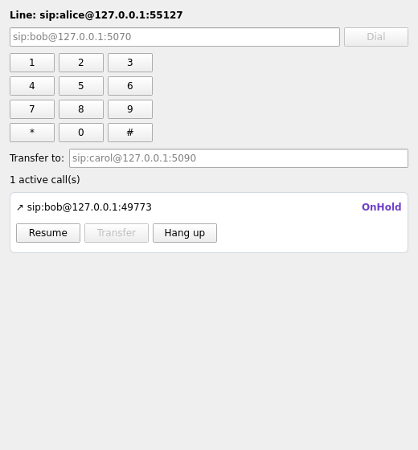
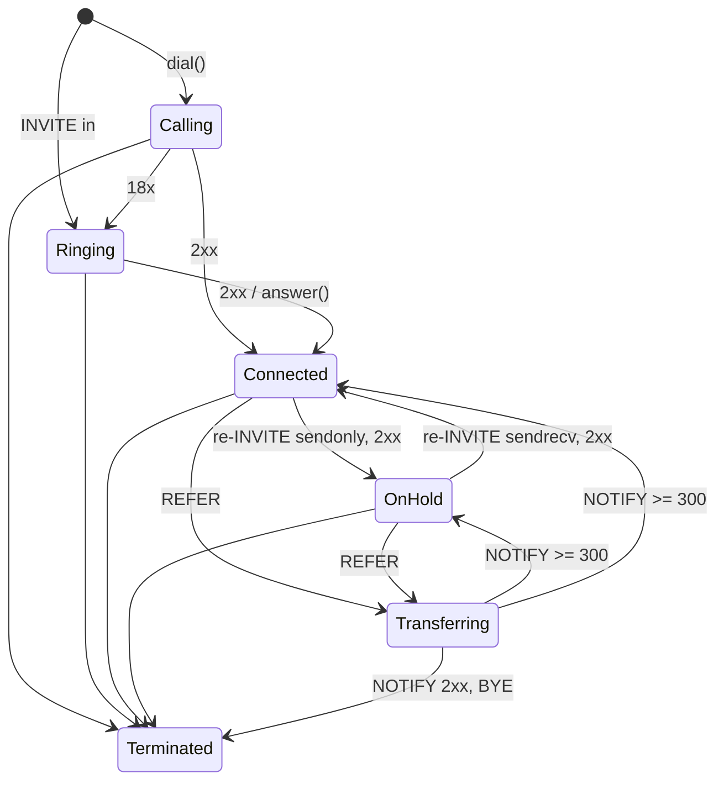

# turret-ua

A SIP softphone in C++17 with a Qt/QML front end. It's small, but every part
was written to be tested hard.

- **SIP stack, hand-written:**
  - RFC 3261 transactions (all four state machines, Timers A-K), dialogs,
    INVITE/ACK/CANCEL/BYE.
  - Re-INVITE hold/resume, REFER blind transfer with NOTIFY progress
    (RFC 3515), REGISTER and INVITE with digest auth.
  - SDP offer/answer (RFC 3264).
- **Call state machine:** checked transitions, plus deterministic tests for the
  real telephony collisions: CANCEL vs 200, BYE vs re-INVITE, re-INVITE glare
  (491 + back-off), REFER while on hold.
- **Media:** G.711 mu-law over RTP, RFC 3550 loss/jitter statistics, RTCP
  receiver reports, and a jitter buffer.
- **Qt/QML UI:** a `QAbstractListModel` fed from the SIP thread through queued
  connections.
- **Verification:**
  - gtest/gmock: 69 tests, including timer schedules checked to the
    millisecond against a mock transport.
  - ThreadSanitizer, ASan+UBSan, and two libFuzzer targets.
  - Interop with **SIPp** and **Asterisk 20**, with every capture checked by
    **tshark**.



*Rendered by the offscreen Qt test while a real call (two SIP stacks, UDP) is
on hold.*

## Results

| What | Result |
|---|---|
| Unit, race and threaded tests (gtest/gmock) | **69/69**. Includes 300-seed random-loss chaos and 200-seed glare runs: 0 illegal state transitions |
| Qt/QML tests (offscreen) | 2/2. The model follows a real call through hold/resume/hangup; Main.qml loads with 0 warnings |
| ThreadSanitizer (clang) | CI: 3 runs x 69 tests, **0 warnings**. 3 threads, real UDP |
| ASan + UBSan | 69/69, 0 reports |
| SIPp interop | **6/6 scenarios**: **2,000 calls at 200 cps, 0 failed**; hold/resume SDP checked by SIPp; 491 back-off measured at 3,031 ms (RFC window 2,100-4,000); REFER/NOTIFY checked by SIPp; RTP echoed with 0 loss |
| Asterisk 20.6 interop | **6/6 checks**: REGISTER + INVITE digest auth, call through the PBX, hold/resume, blind transfer via Asterisk's REFER handling, RTP relayed by Asterisk (295/299 played, 0 late) |
| tshark | **0 malformed/expert-error frames**: every app capture, plus a real `tcpdump -i lo` of the CI interop run (14,399 frames) |
| RFC 3550 jitter vs Wireshark | 5.511 ms (ours) vs 5.517 ms (Wireshark), same stream, computed independently |
| libFuzzer | parser: **3 bugs found and fixed**, then 6.8M clean executions; whole-UA fuzzer: 2.5M executions, 0 findings |

Numbers are from GitHub Actions run 39601194884, all 5 jobs green; see
[results/ci/SUMMARY.md](results/ci/SUMMARY.md). Local WSL numbers are in
`results/local/`. That box was shared with an LLVM build, so quote CI numbers
for anything timing-related.

## Seven bugs the tests found

Details and numbers are in [docs/NOTES.md](docs/NOTES.md#6-bugs-found-and-their-measured-numbers-your-stories).

1. **A leaked INVITE transaction.**
   - **Found by:** the random-loss chaos test, seed 7.
   - **Cause:** a BYE arriving while my 2xx to a re-INVITE was still
     unacknowledged stopped the 2xx retransmission. The peer's INVITE client
     transaction was in Proceeding, which has no timeout in RFC 3261, so it
     leaked forever.
   - **Fix:** keep retransmitting until the ACK (13.3.1.4), plus a Timer C guard.
2. **Hold/resume killed the audio.**
   - **Effect:** after a 2 s hold, **100 of 201** packets were discarded as late
     for the rest of the call.
   - **Cause:** the RTP timestamp didn't keep running during the pause, and the
     jitter buffer never re-anchored.
   - **After the fix:** 198 of 201 played, 0 late, and max jitter went from
     125 ms to 5.5 ms.
3. **Asterisk switches SSRC across hold.**
   - **Effect:** the jitter buffer assumed one stream and played only **191 of
     299** packets.
   - **Fix:** re-anchor on a new SSRC, plus RFC 3550 A.1 probation for sequence
     jumps.
   - **After:** 295 of 299.
4. **One relayed packet made the RFC 3550 jitter estimate 8,894,580 ms.**
   - **Cause:** a marker packet carrying another leg's timestamp.
   - **Fix:** re-baseline on the marker bit, as Wireshark does.
5. **Parser: fold onto an empty value** (fuzzer, after 54,781 executions).
   `Call-ID:` followed by a folded ` abc` parsed as `" abc"`, which is a
   dialog-lookup miss.
6. **Parser: whitespace-only folds and raw NUL bytes** (fuzzer, after 189,166
   executions). Both were accepted.
7. **Parser: our own output failed our own parser** (fuzzer, after 790,231
   executions). 128 headers plus the regenerated Content-Length made 129, over
   the limit. Duplicate Content-Length is now rejected too.

## Design

```
 Qt GUI thread                          SIP + media thread (core::EventLoop: poll + timers + post queue)
 ------------                           ---------------------------------------------------------------
 QML -> CallModel::hold(id) --post-->   UserAgent (dialogs, call state machine, 2xx retransmit, REFER)
                                          |  TransactionLayer (ICT / NICT / IST / NIST, Timers A-K)
                                          |  UdpTransport (+ pcap writer)        MediaManager (RTP/RTCP, jitter buffer)
 CallModel::apply <--QueuedConnection-- on_call_event(CallInfo copy)
```

- **One thread owns all call state.** Datagrams, timers and user commands are
  serialised on one loop, so the state machine has no locks and no two events
  for the same call ever interleave. The races that remain are the ones on the
  wire, and those are tested deterministically.
- **Time and network are interfaces** (`core::Timers`, `core::Transport`).
  Tests use `FakeTimers` and a gmock transport, or the in-memory `SimNetwork`,
  so a 32 s timeout test runs in microseconds and asserts exact retransmit
  timestamps.
- **Every state change goes through `set_state()`**, which checks a transition
  table. Anything illegal (for example Terminated -> Connected after a late
  200) is counted, and every test asserts that count is 0.



Call flows, including the race ladders captured from the tests, are in
[docs/CALL_FLOWS.md](docs/CALL_FLOWS.md).

## Layout

```
src/sip/        message parser/serializer, SDP, digest (MD5), transaction layer
src/ua/         UserAgent: dialogs, call state machine, hold/transfer/register
src/rtp/        G.711, RTP/RTCP + RFC 3550 stats, jitter buffer, live media sessions
src/core/       EventLoop (poll/timers/post), UDP transport, Timers/Transport interfaces
apps/cli/       turret-cli - scriptable softphone used by every interop script
apps/gui/       turret-gui - QML softphone (CallModel : QAbstractListModel)
tests/          gtest/gmock: parser, SDP, digest, transactions, races, RTP, threaded, Qt
fuzz/           libFuzzer targets, seed corpora, SIP dictionary, saved regressions
sipp/           SIPp scenarios (hold, 491 glare, REFER transferor)
asterisk/       Asterisk 20 PJSIP config
scripts/        sipp_interop.sh, asterisk_interop.sh, impair_run.sh
tools/          impair-relay (userspace netem: delay/jitter/loss)
bench/          jb-sweep (deterministic jitter-buffer depth vs late-loss study)
```

## Build and run (Linux)

```bash
sudo apt install ninja-build libgtest-dev libgmock-dev qt6-declarative-dev \
  qml6-module-qtquick qml6-module-qtquick-controls qml6-module-qtquick-layouts \
  qml6-module-qtquick-window qml6-module-qtquick-templates qml6-module-qtqml-workerscript
cmake -S . -B build -G Ninja && cmake --build build
./build/unit_tests
QT_QPA_PLATFORM=offscreen ./build/gui_tests

# two phones
./build/turret-cli --bind 127.0.0.1:5070 --user bob --auto-answer
./build/turret-cli --bind 127.0.0.1:5080 --user alice --call sip:bob@127.0.0.1:5070 \
    --hold-at 2000 --resume-at 4000 --hangup-at 6000 --pcap alice.pcap
./build/turret-gui --bind 127.0.0.1:5090 --user carol

# interop + experiments (need sipp, tshark, asterisk)
scripts/sipp_interop.sh build out
scripts/asterisk_interop.sh build out
scripts/impair_run.sh build out 20
./build/jb-sweep
```

Sanitizers and fuzzing: `-DTU_TSAN=ON` (use clang), `-DTU_ASAN=ON`, and
`-DTU_FUZZ=ON -DCMAKE_CXX_COMPILER=clang++`.

## Limitations

- **Transport and routing:**
  - UDP only. No TCP, TLS or WebSocket transport, no SRTP.
  - No Record-Route/route sets. That's fine through a B2BUA like Asterisk, not
    through a record-routing proxy.
  - IP literals only, no DNS.
- **SIP features:** no PRACK, session timers, attended transfer (Replaces) or
  offerless INVITE.
- **Media:** a tone generator and WAV dump instead of an audio device. The
  jitter buffer is fixed-depth, with silence instead of real loss concealment.
- **Network impairment** comes from a userspace relay, because `tc netem` needs
  root.
- **Timer C** on the INVITE client transaction (180 s) is a deliberate,
  non-standard guard for a UA.
